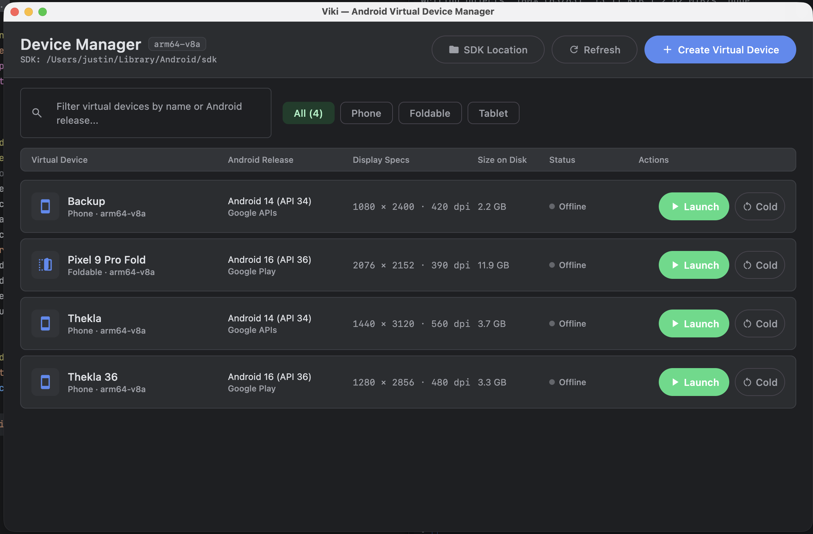

# Viki


A designer-first Android Virtual Device manager for macOS, Windows, and Linux. You can create, launch, and manage emulators without installing Android Studio.



- **SDK setup:** finds an existing Android SDK, or installs platform-tools and the emulator for you.
- **Device presets:** Pixel phones, foldables, and tablets with designer-friendly hardware defaults.
- **Live status:** launch, cold boot, and stop emulators, with boot status tracked through adb.

## Run

Requires JDK 21.

```sh
./gradlew run
```

Build a native installer (DMG, MSI, or DEB) for your OS:

```sh
./gradlew packageDistributionForCurrentOS
```

## Built with

Compose Multiplatform, [Circuit](https://github.com/slackhq/circuit), [Metro](https://github.com/ZacSweers/metro), and Google's Android tools libraries (`sdklib`, `adblib`).

## License

[MIT](LICENSE)
